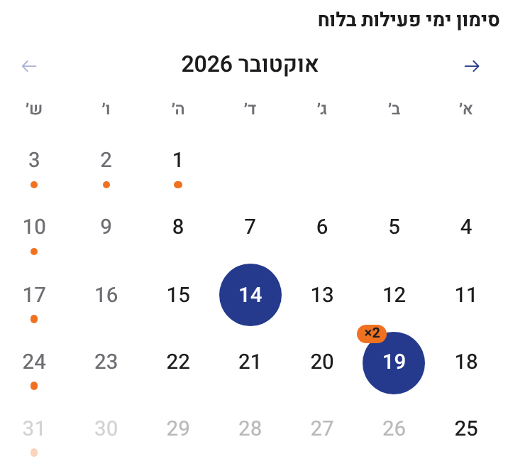
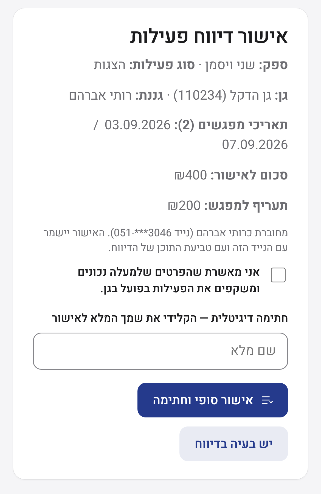
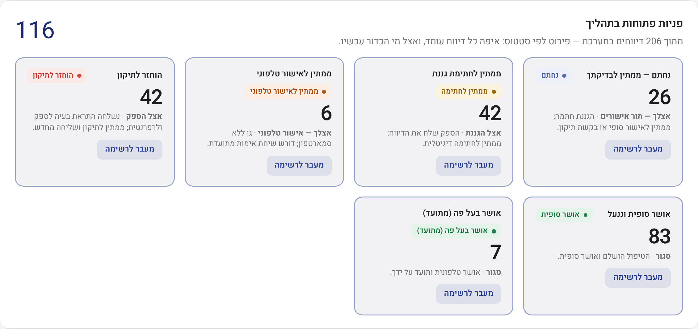

<div dir="rtl">

# מערכת דיווח הגנים · החברה העירונית אריאל

דיווח, אישור ובקרה דיגיטליים של פעילות ספקים חיצוניים (חוגים, הצגות והעשרה) בגני הילדים, במימון סעיף תל"ן.

**פרויקט מסכם · שליו ורגס ורותם · אוקטובר 2026**

| | |
|---|---|
| 🌐 **דמו חי** | https://arielprojectdemo.netlify.app |
| 📄 **מסמך אפיון מערכת (v1.1)** | [docs/system-specification-v1.1.pdf](docs/system-specification-v1.1.pdf) |
| 🛠 **אפיון טכני** | [docs/technical-specification.pdf](docs/technical-specification.pdf) |
| 🗄 **מסד נתונים (SQL Server)** | [database/](database/) · סקריפטים, ERD והוראות הרצה |
| 📘 **מילון נתונים** | [docs/data-dictionary-phase-a.pdf](docs/data-dictionary-phase-a.pdf) |
| 📊 **מצגת** | https://www.figma.com/slides/u1UOlC6fZuM9gAMZuRSEeu |

---

## הבעיה
היום הספקים מדפיסים טבלאות, עוברים בין הגנים ואוספים חתימות של גננות בכתב יד. הטפסים מגיעים לחברת אריאל, ושם מקלידים ובודקים אותם ידנית מול ההתקשרויות והתקרות. מדובר בכ-100 טפסים בחודש, בתהליך איטי, חשוף לטעויות וקשה לבקרה.

## הפתרון
מערכת אחת לשלושה סוגי משתמשים:

| משתמש | מה עושה במערכת |
|---|---|
| **ספק** | נכנס עם מספר ספק וקוד SMS, מסמן מפגשים ביומן לפי גן, ושולח דיווח חודשי מרוכז |
| **גננת** | מקבלת קוד אימות לנייד, רואה רק את המפגשים בגן שלה, ומאשרת או מחזירה לתיקון |
| **רפרנטית (צוות אריאל)** | דשבורד, תור אישורים, חריגות ותקרות, ספקים וגנים, דוח חודשי, ייבוא וייצוא לאקסל, יומן פעולות והגדרות |

## צילומי מסך
| ספק: יומן מפגשים | גננת: אישור בנייד | רפרנטית: דשבורד |
|---|---|---|
|  |  |  |

צילומים נוספים בתיקייה [screenshots](screenshots/).

## ארכיטקטורה מתוכננת (שלב א')
- **מסד נתונים:** Microsoft SQL Server מקומי (2016 ומעלה) על שרת וירטואלי ברשת של אריאל. הנתונים לא יוצאים מהארגון.
- **מקור נתונים:** קבצי האקסל הקיימים (התקשרויות ופרטי מפעילים) מומרים פעם אחת ל-SQL Server, ומאותו רגע המסד הוא מקור האמת.
- **ישויות עיקריות:** ספק, גן, גננת, התקשרות (ספק × גן × שנה, תעריף ותקרות), דיווח, שורת דיווח (עם צילום תעריף), אישור, היסטוריית שינויים.
- **אימות:** קוד חד פעמי ב-SMS לספקים ולגננות.
- **אוטומציות:** תזכורות לגננת ולספק שלא הגיבו, התראה לרפרנטית, התראה לפני חריגה מתקרה, נעילת דיווח מאושר ותור ייצוא.
- **BI:** לוחות בקרה ב-Power BI (עלות לגן, מגמות).
- **שלב ב':** חיבור למערכת השכר פרוסי. התשתית כבר מוכנה במסד (מזהה ספק בפרוסי, תור ייצוא, תצוגת ייצוא).

## על הדמו
- אב טיפוס אינטראקטיבי בקובץ HTML אחד ([index.html](index.html)), בלי שרת ובלי התקנה.
- הנתונים בדמו הם נתוני דוגמה, ונשמרים בדפדפן בלבד (localStorage).
- מותאם למחשב, לטאבלט ולנייד, בעברית מימין לשמאל, עם הגדרות נגישות.
- בדיקת כניסה: בוחרים תפקיד בראש המסך (ספק, גננת או רפרנטית), וכל קוד אימות מתקבל.

## פריסה
האתר מתפרסם ב-Netlify ישירות מהענף `main` של הריפו. אין שלב build (ראו `netlify.toml`).
להרצה מקומית מספיק לפתוח את `index.html` בדפדפן.

## מבנה הריפו
```
index.html          הדמו (אפליקציית עמוד יחיד)
netlify.toml        הגדרות פריסה
docs/               מסמך אפיון מערכת ואפיון טכני
database/           סקריפטי T-SQL, סקריפט ייבוא מהאקסל ותרשים ERD
screenshots/        צילומי מסך של המערכת
```

</div>
