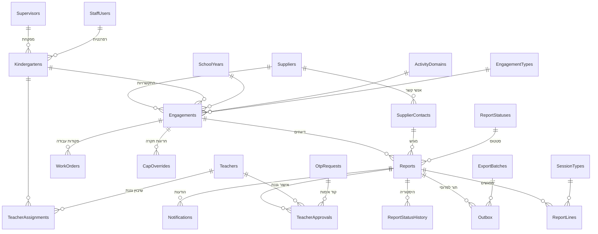

<div dir="rtl">

# מסד הנתונים · שלב א'

**Microsoft SQL Server 2016 ומעלה**, מקומי, על שרת וירטואלי ברשת של אריאל. Collation מומלץ: `Hebrew_100_CI_AS`.

## סדר הרצה
| # | קובץ | מה עושה |
|---|---|---|
| 1 | — | יצירת מסד ריק עם Collation עברי |
| 2 | [01_create_schema.sql](01_create_schema.sql) | 7 סכמות, 32 טבלאות, אילוצים, 4 תצוגות וטריגר לתור הייצוא לפרוסי |
| 3 | [02_enable_history.sql](02_enable_history.sql) | היסטוריית שינויים אוטומטית (Temporal Tables) |
| 4 | [03_reference_data.sql](03_reference_data.sql) | רשימות קבועות והגדרות מערכת |
| 5א | [05_test_data.sql](05_test_data.sql) | **סביבת בדיקות:** נתוני דוגמה עם טלפונים פיקטיביים בלבד |
| 5ב | `04_import_data.sql` | **סביבת ייצור:** נתוני האקסל של הלקוח. מופק על ידי `import_excel.py` |

> `04_import_data.sql` וקובץ הדחויים מכילים נתונים אמיתיים של ספקים וגננות (כולל טלפונים), ולכן **לא נכללים בריפו הציבורי**. הם נמצאים אצל הצוות ויימסרו ללקוח בלבד.

## חלוקה לסכמות
| סכמה | תוכן |
|---|---|
| `ref` | רשימות קבועות: שנות לימודים, תחומי פעילות, סוגי התקשרות, סטטוסים, סיבות דחייה, חגים, הגדרות |
| `core` | נתוני מאסטר: ספקים ואנשי קשר, גנים, גננות ושיבוצים, מפקחות, צוות אריאל, התקשרויות, פקודות עבודה, חריגות תקרה |
| `ops` | דיווחים, שורות דיווח, היסטוריית סטטוסים, אישורי גננת, הודעות |
| `auth` | קודי אימות חד-פעמיים (OTP) ונעילות טלפון |
| `audit` | יומן פעולות |
| `procy` | תשתית לחיבור למערכת השכר פרוסי (שלב ב'): תור ייצוא ואצוות |
| `stg` | ייבוא מהאקסל ושורות שנדחו |

## עקרונות תכנון
- כל טקסט ב-`NVARCHAR` (עברית), סכומים ב-`DECIMAL`, זמנים ב-`DATETIME2` ב-UTC.
- אין מחיקה פיזית של ישויות עסקיות, רק `IsActive = 0`.
- **התקשרות** = ספק × גן × שנת לימודים × תחום, עם תעריף, תקרת מפגשים ותקרה כספית.
- כל שורת דיווח שומרת **צילום של התעריף** ברגע הדיווח, כך שעדכון חוזה לא משנה סכומים שכבר דווחו.
- דיווח שננעל נכנס אוטומטית (טריגר) לתור הייצוא לפרוסי.
- ייבוא שמרני: כפילות או ערך לא בטוח נדחה לתיקון, לא נכנס.

## תרשים ישויות (ERD, הישויות העיקריות)


## ייבוא מחדש מהאקסל
```bash
pip install pandas pyxlsb openpyxl
python import_excel.py <טבלה_מרכזת.xlsb> <פרטי_מפעילים.xlsb> <תיקיית_פלט>
```
הסקריפט מפיק `04_import_data.sql` חדש וקובץ `דחויים_לתיקון.xlsx` עם סיבת הדחייה לכל שורה. בהרצה האחרונה: 195 שורות נדחו ו-105 אזהרות.

## בדיקות שבוצעו
- תחביר T-SQL של קבצים 01, 02, 03 ו-05 נבדק במלואו עם `sqlfluff` (דיאלקט tsql), בלי שגיאות.
- נבדק שכל טבלה ועמודה שמוזכרות ב-INSERT קיימות בסכמה, ושכל מפתח זר מפנה לטבלה שכבר נוצרה.
- הסקריפטים עדיין **לא הורצו על SQL Server בפועל**. ההרצה הראשונה צריכה להיות בסביבת הבדיקות של אריאל.

</div>
