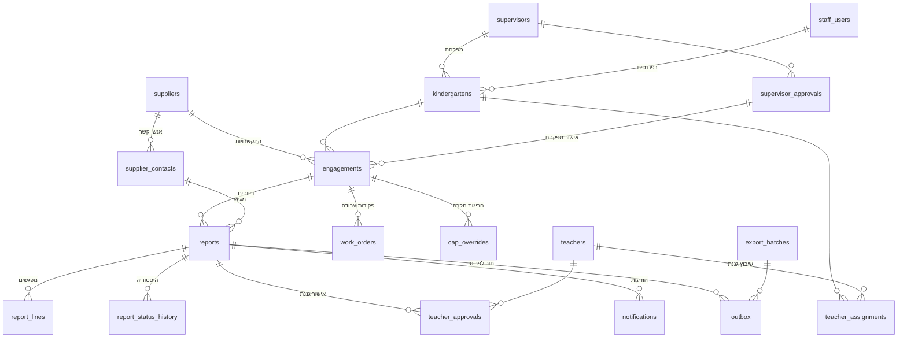

<div dir="rtl">

# מסד הנתונים

PostgreSQL 17 ב-Supabase. הסקריפטים הממוספרים, סדר ההרצה ומדריך הכניסה נמצאים ב-[postgres/](postgres/):
- [סדר הרצה.txt](postgres/סדר%20הרצה.txt): איזה סקריפט מריצים, באיזה סדר ובאיזו סביבה.
- [מדריך כניסה לצד השרת.md](postgres/מדריך%20כניסה%20לצד%20השרת.md): תהליך הכניסה עם SMS ו-Microsoft.
- כל שינוי במבנה המסד נשמר כסקריפט ממוספר חדש. לא משנים את המבנה ידנית בלוח הבקרה.

מילון הנתונים של שלב האפיון: [PDF](../docs/data-dictionary-phase-a.pdf) · [Word](../docs/data-dictionary-phase-a.docx). הוא נכתב לתכנון המקורי ב-SQL Server, ולכן שמות הטבלאות בו ב-PascalCase. המבנה עצמו כמעט זהה.

## חלוקה לסכמות
| סכמה | תוכן |
|---|---|
| `ref` | רשימות קבועות: שנות לימודים, תחומי פעילות, סוגי התקשרות, סוגי מפגש, סטטוסים, סיבות החזרה, חגים, תפקידי צוות והגדרות |
| `core` | נתוני מאסטר: ספקים ואנשי קשר, גנים, גננות ושיבוצים, מפקחות ואישורי מפקחת, צוות אריאל, התקשרויות, פקודות עבודה וחריגות תקרה |
| `ops` | דיווחים, שורות דיווח, היסטוריית סטטוסים, אישורי גננת והודעות |
| `access` | כניסה והרשאות: נעילות נייד, ופונקציות השרת שהאפליקציה קוראת להן |
| `audit` | יומן פעולות |
| `procy` | תשתית לחיבור למערכת השכר פרוסי (שלב ב'): תור ייצוא ואצוות |
| `stg` | ייבוא מהאקסל ושורות שנדחו |
| `history` | היסטוריית שינויים אוטומטית לטבלאות המאסטר ולהגדרות |

## עקרונות
- שמות טבלאות ועמודות ב-snake_case.
- אין מחיקה פיזית של ישויות עסקיות, רק `is_active = false`.
- **התקשרות** = ספק × גן × שנת לימודים × תחום, עם תעריף, תקרת מפגשים ותקרה כספית. הניצול מחושב בתצוגה `core.vw_engagement_usage` (`is_warning`, `is_blocked`).
- כל שורת דיווח שומרת צילום של התעריף מרגע הדיווח (`tariff_applied`), כך שעדכון חוזה לא משנה סכומים שכבר דווחו.
- דיווח שננעל נכנס אוטומטית (טריגר `trg_reports_enqueue_procy`) לתור הייצוא לפרוסי.
- כל שינוי נרשם עם מי שביצע אותו (`app.actor`), וטבלאות `history` שומרות את הגרסאות הקודמות.
- RLS פעיל בכל הטבלאות, ולתפקיד `anon` אין גישה. האפליקציה ניגשת רק דרך פונקציות ב-`access` עם מפתח השרת.

## מחזור החיים של דיווח
הסטטוסים נמצאים ב-`ref.report_statuses`:
1. **טיוטה**
2. **ממתין לחתימת גננת**: הספק שלח.
3. **אושר ע"י הגננת**, או 4. **נדחה ע"י הגננת**: הגננת החזירה עם סיבה, והספק מתקן ושולח שוב.
5. **דורש תיקון**: הרפרנטית החזירה לספק.
6. **אושר סופית**: הרפרנטית אישרה.
7. **אושר ונעול**: הדיווח נכנס אוטומטית לתור הייצוא לפרוסי.

## תרשים ישויות (ERD, הישויות העיקריות)


## ייבוא מהאקסל
```bash
pip install pandas pyxlsb openpyxl
python "postgres/סקריפט ייבוא מאקסל.py" <טבלה_מרכזת.xlsb> <פרטי_מפעילים.xlsb> <תיקיית_פלט>
```
הסקריפט מפיק `04_import_data.sql` וקובץ דחויים לתיקון. שניהם מכילים נתונים אמיתיים של ספקים וגננות, ולכן **לא נכנסים לריפו הציבורי** (הם ב-`.gitignore`).

</div>
